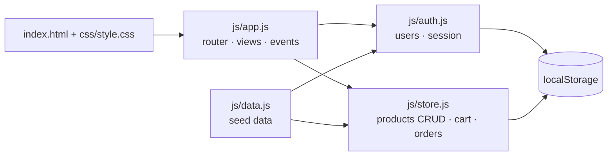

# 🛒 ShopSphere — Production Capstone (E-Commerce Storefront)

A zero-dependency, vanilla HTML5 / CSS3 / JavaScript storefront that combines everything from the course: semantic accessible markup, design tokens + light/dark themes, modular JS, and persistent client state.

**🔗 Live demo:** `https://YOUR-APP.vercel.app` &nbsp;|&nbsp; **📦 Repo:** `https://github.com/YOUR-USERNAME/shopsphere`

## ✨ Features
| Area | Details |
|---|---|
| Authentication (simulated) | Register / sign in / sign out, role-based access (`customer`, `admin`), session in `localStorage` |
| Interactive catalog | Live search, category chips, sorting, stock badges, sold-out handling |
| Cart & checkout | Quantity controls capped by stock, running total, order creation, stock decrement |
| Dynamic CRUD (admin) | Add, edit, delete products with validation; changes reflect instantly in the catalog |
| Orders | Customers see their orders; admin sees all |
| Persistent state | Products, cart, users, orders and theme survive refresh |
| UX & a11y | Skip link, ARIA live toast, `aria-pressed` chips, visible focus, keyboard friendly, `prefers-reduced-motion` |
| Responsive | Mobile-first grid, no horizontal scroll, glassmorphism light/dark themes |

**Demo accounts:** `demo@shop.dev / demo123` (customer) · `admin@shop.dev / admin123` (admin)

## 🏗️ Architecture

```
shopsphere/
├── index.html      # shell, fonts, no-flash theme script
├── css/style.css   # tokens, layout, themes
├── js/data.js      # seed products & users
├── js/auth.js      # simulated auth
├── js/store.js     # data layer
├── js/app.js       # UI layer
└── vercel.json
```
Scripts are classic (non-module) files, so the app also works by double-clicking `index.html`.

## 🚀 Setup
```bash
git clone https://github.com/YOUR-USERNAME/shopsphere && cd shopsphere
npx serve .          # or: python -m http.server 8000
```
## ☁️ Deploy
- **Vercel:** import the GitHub repo → Framework "Other" → Deploy (no build command, output dir `.`)
- **Netlify:** drag-and-drop the folder, or connect the repo
- **GitHub Pages:** Settings → Pages → Deploy from `main` / root

## ⚠️ Notes
Auth is a front-end simulation for learning; real apps need a backend with hashed passwords and tokens.

## 📜 License
MIT
